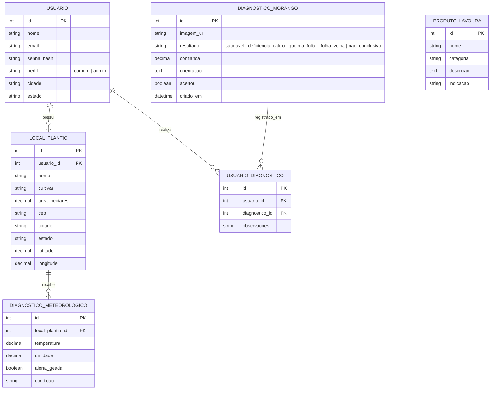

# 🍓 BerryHealth AI

> Diagnóstico por foto da deficiência de cálcio e queima foliar, com alertas climáticos para o morangueiro no Sul de Minas.

**Projeto Integrador · Programação Backend**  
Universidade do Vale do Sapucaí (UNIVÁS) · Pouso Alegre, MG  
Professor: **Raffael Carvalho** · Orientador: **Flávio Belizário da Silva Mota**  
**Versão Atual:** `v0.2.0` (Release 2 - Fundação)

---

## 👥 Equipe e papéis

| Integrante | Papéis |
|---|---|
| **Cezar Vitor Leite Junior** | Product Owner, Fullstack, Banco/Deploy |
| **Igor Gabriel Silva Prado** | Fullstack, Banco/Deploy |
| **Rodrigo Marques de Castro** | Fullstack, Banco/Deploy |

---

## 📌 Status das Entregas

- [x] **Release 1 (Encontro 1): Concepção** — Tema aprovado, backlog em histórias de usuário, modelo de dados (DER) e tecnologias definidas.
- [x] **Release 2 (Encontro 2): Fundação** — Frontend e backend integrados; banco com todas as entidades e relacionamentos modelados (1:N e N:N); autenticação de ponta a ponta com hash (bcrypt); 1º CRUD completo (Locais de Plantio / Talhões com busca e paginação); layout base responsivo com identidade visual; suíte de testes automatizados e configuração de deploy inicial. Tag Git `v0.2`.
- [ ] **Release 3 (Encontro 3): Funcionalidades** — Todos os CRUDs, perfis e permissões avançadas, integração final com o modelo CNN.
- [ ] **Release 4 (Encontro 4): Versão Final** — Extras concluídos, deploy em produção testado e ensaio da apresentação.

---

## 🎯 Problema

Na região de Pouso Alegre, no Sul de Minas, os produtores de morango, em grande parte familiares, decidem o manejo por observação visual e previsão genérica do tempo, expostos a quatro riscos:

1. **Deficiência de cálcio (tipburn)**: risco principal. Necrosa a ponta das folhas jovens, atinge o cálice do fruto e é confundida com queima foliar e senescência. Geralmente decorre do transporte deficiente do nutriente, e não de sua falta no solo.
2. **Mofo cinzento (*Botrytis cinerea*)**: apodrece flores e frutos.
3. **Geada**: frequente na Serra da Mantiqueira.
4. **Colheita fora do ponto**: gera frutos ácidos ou em decomposição.

Redes neurais convolucionais (CNNs), que preservam a estrutura espacial das imagens, permitem automatizar o diagnóstico visual.

## 👨‍🌾 Público-alvo

Pequenos e médios produtores de morango do Sul de Minas, sem estação meteorológica nem agrônomo constante.

## 📦 Nome do produto

**BerryHealth AI**

---

## 🚀 Como Executar o Projeto Localmente

### Pré-requisitos
- Node.js instalado (v18 ou superior, recomendado v22)
- Git

### Passo a Passo

1. **Clone o repositório:**
   ```bash
   git clone https://github.com/Ig0r-or/StrawBerry_Health_CNN.git
   cd StrawBerry_Health_CNN
   ```

2. **Instale as dependências:**
   ```bash
   npm install
   ```

3. **Configure as variáveis de ambiente:**
   Copie o arquivo de exemplo para `.env`:
   ```bash
   cp .env.example .env
   ```
   *Nota: Por padrão, o sistema utiliza SQLite (`database.sqlite`), que não requer nenhuma instalação de servidor de banco de dados externo. Se desejar usar MySQL, altere `DB_DIALECT=mysql` e configure as credenciais no `.env`.*

4. **Popule o banco de dados com dados de teste (Seed):**
   ```bash
   npm run seed
   ```

5. **Inicie a aplicação:**
   ```bash
   npm start
   # ou para desenvolvimento com live-reload:
   npm run dev
   ```

6. **Acesse no navegador:**
   Abra [http://localhost:3000](http://localhost:3000)

---

## 🔑 Usuários de Teste (para Demonstração e Avaliação)

O comando `npm run seed` já cadastra automaticamente dois usuários prontos:

| Perfil | E-mail | Senha | Descrição |
|---|---|---|---|
| **Administrador** | `admin@berryhealth.com` | `admin123` | Perfil de gestão global da plataforma |
| **Produtor Rural** | `produtor@berryhealth.com` | `produtor123` | Perfil de produtor com talhões cadastrados no Sul de Minas |

---

## 🧪 Testes Automatizados (Mínimo de 10)

O projeto conta com uma suíte de testes de integração automatizados ponta a ponta:

```bash
npm test
```

### Casos de Teste Cobertos:
1. `GET /login` — Rota pública com retorno HTTP 200 e formulário renderizado.
2. `GET /locais` sem autenticação — Proteção de rota privada com redirecionamento para `/login`.
3. `POST /login` — Autenticação com verificação de senha criptografada via BCrypt e emissão de cookie de sessão.
4. `GET /dashboard` — Renderização do painel autenticado com dados do usuário logado.
5. `GET /locais` — Listagem dos locais de plantio do produtor (Leitura / Read).
6. `POST /locais` — Cadastro completo de novo talhão associado ao usuário (Criação / Create).
7. `GET /locais?q=...` — Mecanismo de busca e filtro em tempo real.
8. `POST /locais/:id/editar` — Atualização dos dados do talhão no banco (Atualização / Update).
9. `POST /locais/:id/excluir` — Remoção do registro no banco com feedback (Exclusão / Delete).
10. `GET /logout` — Encerramento seguro da sessão com destruição de cookie.

---

## ☁️ Deploy Inicial

O projeto está configurado para deploy imediato com 1 clique no **Render** ou em qualquer plataforma compatível com contêineres:

- **`render.yaml`**: Blueprint de infraestrutura como código (IaC) para o Render (plano gratuito), configurando runtime Node, persistência e build automatizado.
- **`Dockerfile`**: Imagem Alpine Linux leve e otimizada com Node 22 para execução em contêineres.

### Publicando no Render:
1. Acesse [render.com](https://render.com) e conecte sua conta do GitHub.
2. Selecione **"New +"** → **"Blueprint"** e aponte para o repositório `StrawBerry_Health_CNN`.
3. O Render detectará automaticamente o arquivo `render.yaml` e publicará o serviço em uma URL pública HTTPS gratuita (ex: `https://berryhealth-ai.onrender.com`).

---

## 🤖 Seção "Uso de IA"

Conforme diretrizes acadêmicas da disciplina:

- **Quais ferramentas foram usadas e para quê:**
  - Foi utilizado o assistente **Google Antigravity** (motor Gemini 3.8 Flash) para auxílio na estruturação da arquitetura MVC em Node.js/Express, geração de scripts de seed e modelagem ORM com Sequelize, além da criação da suíte automatizada de 10 testes de integração.
- **O que funcionou bem e onde a IA errou:**
  - *Funcionou muito bem:* Geração dos esquemas relacionais (1:N e N:N), padronização visual em CSS das telas EJS a partir do protótipo v0.01 e testes HTTP nativos.
  - *Desafios/Ajustes:* A configuração inicial de rede exigiu binding explícito em `0.0.0.0` para permitir acesso seguro a portas no ambiente local, e o driver de banco foi desenhado como dual-driver (SQLite padrão + MySQL opcional) para evitar que a demonstração dependesse de serviço MySQL local.
- **Como a equipe validou o que a IA gerou:**
  - Todos os códigos foram revisados manualmente pela equipe;
  - Os testes foram executados via terminal com assertivas rigorosas de status code, cabeçalhos de redirecionamento e integridade de dados;
  - A interface gráfica foi testada e navegada ponta a ponta simulando um produtor real em Pouso Alegre.

---

## 🗄️ Modelo de Dados (DER)



---

## 📝 Checklist de Métricas Cumpridas na Release 2

| Requisito do Edital | Situação na Release 2 | Evidência |
|---|---|---|
| **Frontend e Backend Integrados** | ✅ Concluído | Node.js + Express servindo views EJS dinâmicas |
| **Banco de Dados Modelado** | ✅ Concluído | 5 entidades + 1 tabela pivot N:N com Sequelize |
| **Relacionamento 1:N e N:N** | ✅ Concluído | 1:N (Usuario -> Locais) e N:N (Usuario <-> Diagnosticos) |
| **Autenticação com Hash** | ✅ Concluído | BCrypt (salt 10 rounds) com sessão segura |
| **Autorização de Perfis** | ✅ Concluído | Perfis `admin` e `comum` verificados no backend |
| **1º CRUD Completo** | ✅ Concluído | Locais de Plantio (Criar, Listar, Editar, Excluir) |
| **Busca e Paginação** | ✅ Concluído | Implementado em `/locais` com query `?q=` e `?pagina=` |
| **Layout Base e Navegação** | ✅ Concluído | Navbar com perfil, dropdown, design responsivo |
| **Testes Automatizados (≥10)** | ✅ Concluído | 10 testes cobrindo todo o fluxo em `npm test` |
| **Deploy Inicial** | ✅ Concluído | Configurações `render.yaml` e `Dockerfile` inclusas |
| **Git Tag v0.2** | ✅ Concluído | Tag `v0.2` criada no repositório Git |

---

## 📚 Referências

- HARIRI, M.; AVŞAR, E.; SARIDAŞ, M. A. **Image dataset for tipburn disorder detection in strawberry leaves**. Versão 1. Mendeley Data, 2022. DOI: 10.17632/trwfmgjjr6.1. Disponível em: <https://data.mendeley.com/datasets/trwfmgjjr6/1>.
- BONES, S. A. S. **Mofo cinzento na cultura do morangueiro**. Elevagro, 17 fev. 2022. Disponível em: <https://elevagro.com/mofo-cinzento-na-cultura-do-morangueiro/>.
- CANTILLANO, R. F. Colheita. In: EMBRAPA. **Agência de Informação Tecnológica: morango**. Brasília, DF: Embrapa, 20 dez. 2021. Disponível em: <https://www.embrapa.br/web/agencia-de-informacao-tecnologica/cultivos/morango/producao/colheita>.
