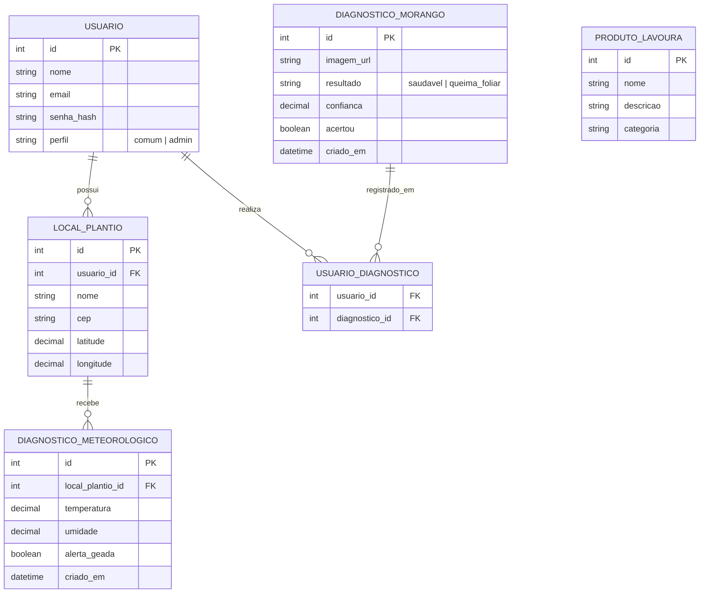

# 🍓 BerryHealth AI

> Diagnóstico por foto da deficiência de cálcio e queima foliar, com alertas climáticos para o morangueiro no Sul de Minas.

**Release 1 (Encontro 1): Concepção**
Universidade do Vale do Sapucaí (UNIVÁS) · Orientador: Flávio Belizário da Silva Mota

---

## 👥 Equipe e papéis

| Integrante | Papéis |
|---|---|
| **Cezar Vitor Leite Junior** | Product Owner, Fullstack, Banco/Deploy |
| **Igor Gabriel Silva Prado** | Fullstack, Banco/Deploy |
| **Rodrigo Marques de Castro** | Fullstack, Banco/Deploy |

---

## 🎯 Problema

Na região de Pouso Alegre, no Sul de Minas, os produtores de morango, em grande parte familiares, decidem o manejo por observação visual e previsão genérica do tempo, expostos a quatro riscos:

1. **Deficiência de cálcio (tipburn)**: risco principal. Necrosa a ponta das folhas jovens, atinge o cálice do fruto e é confundida com queima foliar e senescência. Geralmente decorre do transporte deficiente do nutriente, e não de sua falta no solo.
2. **Mofo cinzento (*Botrytis cinerea*)**: apodrece flores e frutos.
3. **Geada**: frequente na Serra da Mantiqueira.
4. **Colheita fora do ponto**: gera frutos ácidos ou em decomposição.

Redes neurais convolucionais (CNNs), que preservam a estrutura espacial das imagens, permitem automatizar o diagnóstico visual.

## 👨‍🌾 Público-alvo

Pequenos e médios produtores de morango do Sul de Minas, sem estação meteorológica nem agrônomo constante.

## 📦 Nome do produto

**BerryHealth AI**

## 🚀 Objetivo e escopo do MVP

Seguindo a metodologia **Running Lean** (modelo de negócio *Lean Canvas*), o MVP é o **diagnóstico por foto da queima foliar**. Os módulos seguintes emitirão recomendações climáticas, deficiência de cálcio, mofo cinzento e ponto de colheita.

**Fluxo essencial:** `foto → diagnóstico → orientação → registro`

O produtor envia a foto de uma folha jovem, seguindo um guia de captura. O sistema verifica a qualidade da imagem e uma CNN classifica a folha em **saudável** ou **queima foliar**, devolvendo a confiança, uma orientação básica e a pergunta "acertou ou errou?", que realimenta a base de dados.

**Fora do escopo do MVP:** alertas climáticos, aplicativo nativo, sensores, prescrição de doses e cobrança.

### Resultado preliminar da CNN

- Acurácia no teste: **99,4%**
- Perda no treino: **0,019** · Perda no teste: **0,028**
- A diferença mínima entre as perdas indica que o modelo generaliza com alta precisão imagens inéditas.
- Base de imagens: HARIRI, AVŞAR e SARIDAŞ (2022), *Image dataset for tipburn disorder detection in strawberry leaves*, Mendeley Data. DOI: [10.17632/trwfmgjjr6.1](https://data.mendeley.com/datasets/trwfmgjjr6/1)

---

## 📝 Backlog (histórias de usuário)

| # | Como... | Quero... | Para que... |
|---|---|---|---|
| 1 | Como não mexo muito com tecnologia | Quero que seja simples de usar | Para que eu possa entender de forma intuitiva |
| 2 | Como gestor da minha plantação | Quero receber um feedback visual sobre a queima foliar | Para que eu possa me prevenir |
| 3 | Como estou com problema na minha lavoura | Quero uma solução rápida e completa | Para que eu possa resolver o mais rapidamente |

---

## ✅ Checklist de requisitos

### Requisitos obrigatórios

| Requisito | Como será cumprido |
|---|---|
| **Telas** | Cadastro, Login, Home, Diagnóstico por foto, Feedback, Diagnóstico meteorológico, Perfil, Locais de Plantio, Informação de Produtos para Lavoura de Morango |
| **Entidades** | Usuário, Diagnóstico Morango, Diagnóstico Meteorológico, Local de Plantio |
| **CRUD** | Usuário, Local de Plantio, Informação de Produtos para Lavoura de Morango |
| **Relacionamentos** | Um usuário tem um ou muitos Locais de Plantio. Muitos usuários têm muitos diagnósticos por foto. |
| **Regra de negócio** | CNN para classificação da queima foliar |
| **Listagem** | Informação de Produtos para Lavoura de Morango |
| **Autenticação** | Cadastro, login e logout, com senhas salvas com hash |
| **Autorização** | Perfis de Usuário comum e Admin |
| **Proteção** | Telas e endpoints privados bloqueados para quem não está logado |
| **Validação** | Validação no backend com mensagens claras |
| **Boas práticas** | ORM ou queries parametrizadas (contra SQL Injection); segredos no `.env`, fora do Git |
| **Git** | [Repositório do projeto](https://github.com/Ig0r-or/StrawBerry_Health_CNN) |
| **Deploy** | Netlify ou Vercel |

### Extras escolhidos (total: 9 pontos)

- [ ] Layout responsivo (celular)
- [ ] Upload de arquivos ou imagens
- [ ] Recuperação de senha por e-mail
- [ ] Integração com API externa (CEP, mapas, clima…)
- [ ] Dashboard com gráficos
- [ ] Notificações por e-mail

---

## 🛠️ Tecnologias

| Tecnologia | Uso previsto |
|---|---|
| **Node.js** | Backend, API e autenticação |
| **Python** | Treino e execução da CNN |
| **React** | Interface web responsiva |
| **EJS** | Templates renderizados no servidor |
| **MySQL** | Banco de dados relacional |

**Justificativa:** são as linguagens e ferramentas com as quais a equipe tem mais familiaridade, o que reduz o tempo de aprendizado e permite focar na entrega do MVP.

---

## 🖼️ Esboço das telas

| Tela | Função |
|---|---|
| Cadastro / Login | Acesso e criação de conta, com recuperação de senha por e-mail |
| Home | Resumo da lavoura, atalhos e dashboard com gráficos |
| Diagnóstico por foto | Guia de captura, upload da foto e resultado da CNN |
| Feedback | Confirmação "acertou ou errou?" sobre o diagnóstico |
| Diagnóstico meteorológico | Dados de clima e alertas (geada) por local de plantio |
| Perfil | Dados do usuário |
| Locais de Plantio | CRUD dos locais de cultivo |
| Informação de Produtos | Listagem e CRUD de produtos para a lavoura de morango |

> 📌 Os protótipos (Figma/Excalidraw/papel) devem ser adicionados em `docs/telas/` e linkados aqui.

---

## 🗄️ Modelo de dados (DER)

---

## 🔗 Repositório e gestão

- **Repositório Git (todos os membros):** [github.com/Ig0r-or/StrawBerry_Health_CNN](https://github.com/Ig0r-or/StrawBerry_Health_CNN)

---

## 🔭 Próximos passos

- Validar o mockup com produtores.
- Coletar fotos locais rotuladas.
- Calibrar as regras com um agrônomo.
- Incluir alertas climáticos, mofo cinzento e ponto de colheita nas versões seguintes.

---

## 📚 Referências

- HARIRI, M.; AVŞAR, E.; SARIDAŞ, M. A. **Image dataset for tipburn disorder detection in strawberry leaves**. Versão 1. Mendeley Data, 2022. DOI: 10.17632/trwfmgjjr6.1. Disponível em: <https://data.mendeley.com/datasets/trwfmgjjr6/1>. Acesso em: 8 out. 2026.
- BONES, S. A. S. **Mofo cinzento na cultura do morangueiro**. Elevagro, 17 fev. 2022. Disponível em: <https://elevagro.com/mofo-cinzento-na-cultura-do-morangueiro/>. Acesso em: 8 out. 2026.
- CANTILLANO, R. F. Colheita. In: EMBRAPA. **Agência de Informação Tecnológica: morango**. Brasília, DF: Embrapa, 20 dez. 2021. Disponível em: <https://www.embrapa.br/web/agencia-de-informacao-tecnologica/cultivos/morango/producao/colheita>. Acesso em: 8 out. 2026.
